# Registo da Ficha SERVICEWORKER02

## 1. Contrato e estratégia

### Tabela de decisões de cache e repetição de pedidos

| Pedido | Cache-Control | Depende do cookie? | Origem do pedido | Repetição segura? |
|---|---|---|---|---|
| POST /v2/sessao | no-store | Não, recebe credenciais | Página | Não repetir automaticamente |
| GET /v2/sessao | no-store | Sim | Página | Sim |
| DELETE /v2/sessao | no-store | Sim | Página | Idempotente quanto ao efeito |
| GET /v2/categorias | public, max-age=86400 (valor previsto; confirmar cabeçalho real) | Não | Página / Service Worker | Sim |
| GET /v2/sugestoes | private, no-cache | Sim | Página | Sim |
| POST /v2/sugestoes sem Idempotency-Key | no-store | Sim | Página | Não |
| POST /v2/sugestoes com Idempotency-Key | no-store | Sim | Página / Service Worker | Sim, com a mesma chave e conteúdo, dentro do prazo de retenção |
| GET /v2/sugestoes/alteracoes?desde=0 | private, no-store | Sim | Página / Service Worker | Sim |

**Cache.** As categorias são públicas e podem ser guardadas na Cache API. As respostas de sessão e as sugestões privadas não devem ser partilhadas através da cache da interface.

**Cookies.** O browser envia o cookie de sessão nos pedidos elegíveis da mesma origem; o Service Worker não necessita de ler o seu valor.

**GET e POST.** GET consulta dados sem os alterar. Um POST pode ter sido processado mesmo quando a resposta se perde, pelo que a repetição exige uma `Idempotency-Key` persistida com a operação.

**Sincronização.** O endpoint `/v2/sugestoes/alteracoes?desde=n` devolve alterações posteriores ao cursor, reduzindo pedidos e transferência de dados.

## 2. Implementação

### Servidor

O endpoint `POST /v2/sugestoes` aceita uma `Idempotency-Key` UUID. O servidor guarda temporariamente, em memória e durante 24 horas, a associação entre operação, utilizador e conteúdo. A repetição com a mesma chave e corpo devolve a resposta original e `Idempotent-Replayed: true`; com corpo diferente devolve `409 Conflict`. Uma chave inválida é rejeitada com `400 Bad Request`.

As variáveis `SIMULAR_PERDA_RESPOSTA` e `SIMULAR_503` permitem reproduzir falhas. O endpoint `GET /v2/sugestoes/alteracoes?desde=n` suporta sincronização incremental com cursor.

### Service Worker e recuperação

O Service Worker suporta o envio de pendentes com Background Sync nos browsers compatíveis. Existe um mecanismo alternativo associado à conectividade e à visibilidade da página. Para erros temporários, as tentativas são espaçadas por *exponential backoff* com *jitter*.

### IndexedDB

A base de dados `sugestoes-bd` contém as *object stores* `meta` (incluindo cursor e proprietário), `pendentes` (fila local) e `sugestoes` (cópia local). As pendentes sobrevivem à falta de rede e à perda de autenticação; uma rejeição definitiva é sinalizada sem bloquear as outras operações.

## 3. Resultados dos testes HTTP (PowerShell)

Os testes T1–T4 foram executados com `Invoke-WebRequest` e `Invoke-RestMethod`, usando a sessão da Ana Silva (`12345`).

| Teste | Procedimento | Resultado observado | Estado |
|---|---|---|---|
| T1 | Mesmo POST, chave UUID e corpo, duas vezes | `201`, `201`; mesmo `Location` (`/v2/sugestoes/5`); segundo `Idempotent-Replayed: true`; sem duplicação | Passou |
| T2 | Reutilização da chave de T1 com título diferente | `409 Conflict` | Passou |
| T3 | `GET .../alteracoes?desde=0` e depois `desde=5` | Primeiro: três alterações (IDs 1, 2, 5), cursor 5; segundo: `alteracoes: []`, cursor 5 | Passou |
| T4 | Cursor `desde=abc`; pedido sem cookie | `400` com detalhes de validação; `401` sem autenticação | Passou |

**Observação:** a resposta 401 indicou «É necessária autenticação através de um token Bearer», embora o contrato desta ficha utilize cookie de sessão. Esta inconsistência de mensagem deve ser revista no servidor.

## 4. Cenários de verificação e capturas

> **Nota de rigor:** os cenários abaixo seguem a numeração do ponto 4.6 do enunciado. Alguns ensaios realizados foram variantes e estão assinalados como tal. As capturas provêm da conversa e estão na pasta `capturas/`.

### (a) Migração da API04

**Por confirmar integralmente.** O enunciado exige criar pendentes na versão API04, abrir a versão nova e demonstrar que os registos permanecem intactos, com chave, e que existe o índice `porUtilizador`. As capturas disponíveis não comprovam toda esta sequência de migração.

### (b) Background Sync no Chrome

Foi criada uma sugestão offline e testada a recuperação da conectividade. Foram examinadas as ferramentas de desenvolvimento do Chrome e a sincronização de pendentes.

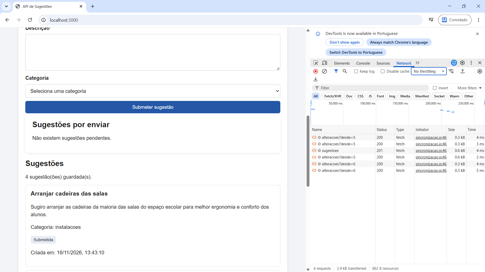

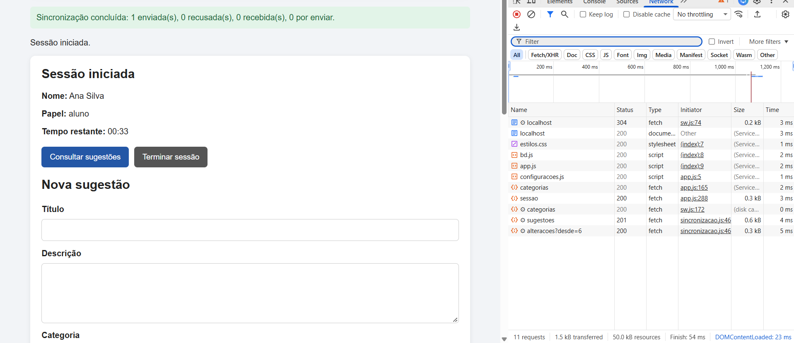

**Resultado:** recuperação de pendentes observada. Para comprovar estritamente o cenário, a captura deve mostrar também o registo da etiqueta e o evento de Background Sync no painel específico do Chrome.

### (c) Rede do sistema desligada e separador fechado

**Por confirmar integralmente.** O enunciado pede desligar a rede do sistema operativo, fechar o separador e verificar que o servidor recebeu a sugestão sem página aberta. O simples modo Offline das DevTools não é equivalente.

### (d) Plano B no Firefox

Foram testados o modo Offline, a recuperação da ligação e a alternância de visibilidade do separador. A aplicação retomou o envio através do mecanismo alternativo.

**Resultado:** funcionamento do plano B observado.

### (e) Perda da resposta e idempotência

Foi simulada a perda de resposta e observada uma repetição reconhecida pelo servidor, com `Idempotent-Replayed: true` e o mesmo `Location`.

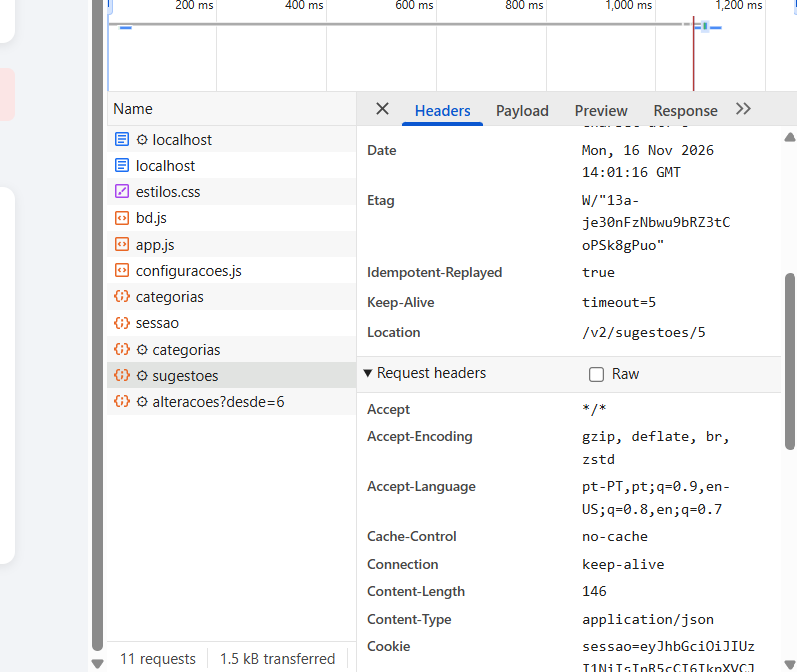

**Resultado:** a repetição não criou uma segunda sugestão.

### (f) Erros 503 e backoff no Firefox

Foram simuladas falhas temporárias. Nos registos observados, os atrasos foram aproximadamente **836 ms**, **2588 ms** e **4241 ms**, compatíveis com crescimento exponencial e variação aleatória.

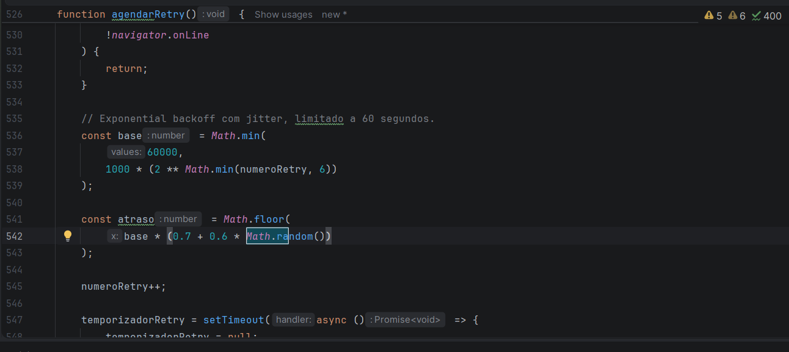

**Resultado:** os intervalos aumentaram de forma não fixa, como esperado com *backoff* e *jitter*.

### (g) Sugestão inválida entre válidas

Foram criadas offline três sugestões: «Melhorar o estacionamento da escola», «Melhorar os espaços verdes da escola» e «Melhorar o serviço de refeições». A terceira foi alterada diretamente na IndexedDB para usar `categoria_invalida`.

Ao recuperar a ligação, as duas primeiras foram enviadas e a terceira ficou pendente com o erro «Os dados da sugestão são inválidos».

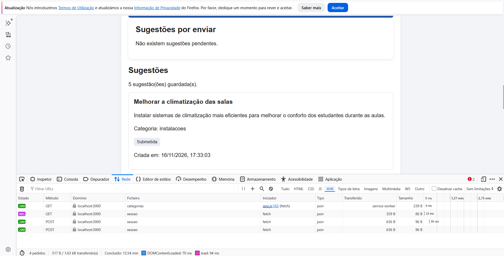

**Resultado:** uma operação rejeitada não bloqueou as restantes.

**Diferença face ao enunciado:** foi invalidada a **categoria**, não criado um **título demasiado curto na posição intermédia**. A regra geral foi testada, mas não exatamente com os dados e a ordem pedidos.

### (h) Expiração da sessão com pendente

Foi criada offline a sugestão «Melhorar a iluminação da biblioteca». O cookie `sessao` foi eliminado para simular perda de autenticação. Após regressar online, a aplicação solicitou nova autenticação.

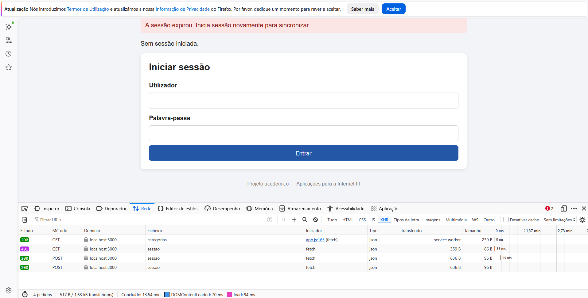

A sugestão continuava na IndexedDB, em `pendentes`, com a chave local `8`.

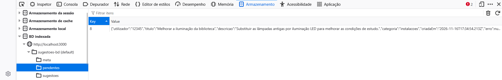

Depois de iniciar sessão novamente, a fila ficou vazia e a sugestão apareceu na lista.

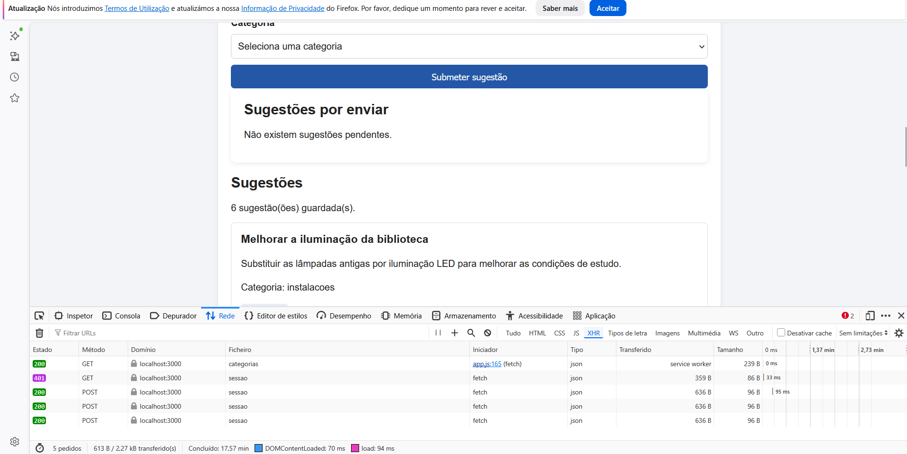

**Resultado:** a pendente não foi perdida e foi sincronizada após autenticação.

**Diferença face ao enunciado:** o teste eliminou manualmente o cookie; não foi demonstrada a expiração natural com `JWT_VALIDADE=30`, nem provada por registo a ausência absoluta de POST do Service Worker.

### (i) Sincronização entre browsers

Foi criada no **Chrome** a sugestão «Melhorar a rede Wi-Fi da escola».

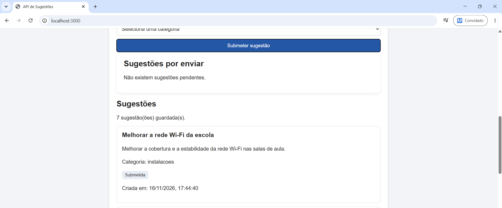

Sem atualizar manualmente a página, a sugestão apareceu no **Firefox**.

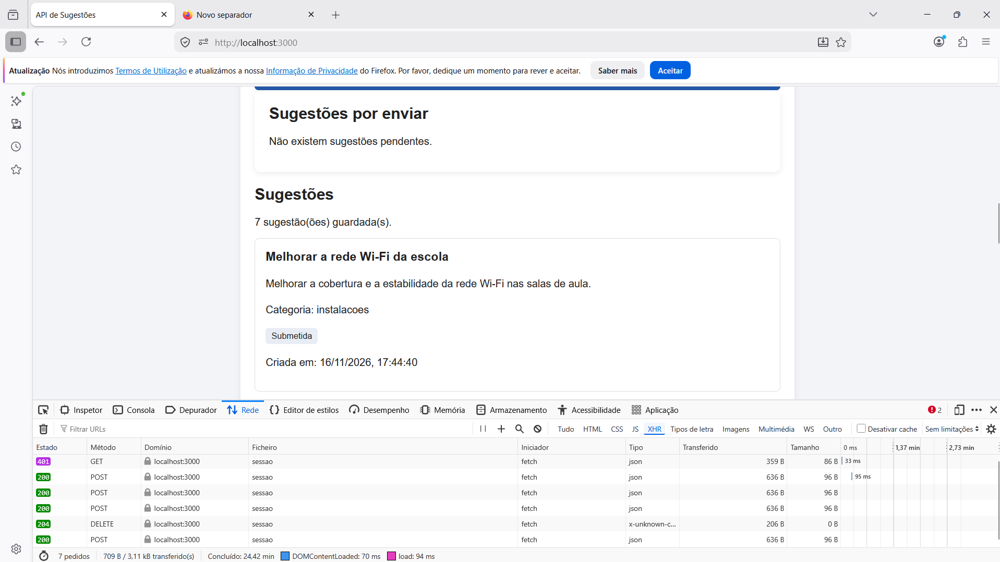

Na IndexedDB do Firefox, a *object store* `meta` apresentava `cursor:12345` com valor **9**.

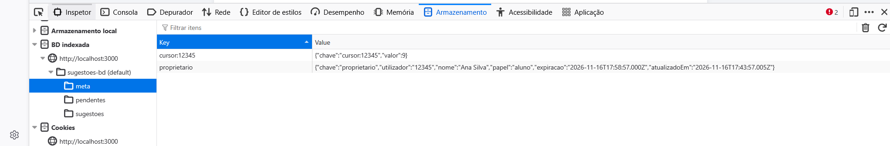

**Resultado:** propagação de alteração entre browsers e cursor 9 confirmados.

**Diferença face ao enunciado:** o professor pede **Firefox → Chrome**, enquanto o ensaio efetuado foi **Chrome → Firefox**. A captura também não regista o cursor anterior. Para cumprimento literal, repetir na direção pedida e capturar o cursor do Chrome antes/depois.

### (j) Atualização da aplicação com dois separadores API04

**Por confirmar.** Não há evidência suficiente de atualização entre duas versões abertas e eliminação da cache `interface-v2`.

### Tabela de gatilhos

| Gatilho | Chrome: o que acontece | Firefox: o que acontece | Quem executa a sincronização | Que pendentes são enviadas |
|---|---|---|---|---|
| Criação de pendente com ligação | Envio imediato ou agendado | Envio imediato ou agendado | Página / SW, conforme suporte | Do utilizador autenticado |
| Criação de pendente sem ligação | Guarda na IndexedDB | Guarda na IndexedDB | Envio adiado | Nenhuma até haver rede |
| Entrada em `com-sessao` | Retoma possível | Retoma possível | Página / SW | Do utilizador autenticado |
| Evento `online` | Retoma possível | Plano B observado | Página e/ou SW | Pendentes elegíveis |
| Separador volta a ficar visível | Retoma possível | Plano B observado | Página | Pendentes elegíveis |
| Rede volta com separador fechado | Background Sync, se suportado e autorizado | Não garantido sem página | SW no Chrome, quando acionado | Pendentes elegíveis com sessão válida |
| 503 do servidor | Repetição com atraso | Backoff observado | Executor do envio | Pendentes elegíveis; erros temporários |
| 401 com separador fechado | Deve preservar a fila | Deve preservar a fila | SW, se executado; sem envio autenticado | Nenhuma até nova sessão |

*As células não verificadas diretamente descrevem o comportamento esperado da implementação, não uma medição feita nos dois browsers.*

## 5. Respostas e reflexão (ponto 4.7)

### 5.1. Edições offline concorrentes

Se a mesma sugestão fosse editada offline em dois computadores, o *push* simples poderia fazer com que a **última edição recebida pelo servidor substituísse a anterior**, perdendo alterações do outro computador. Para detetar o conflito, o contrato poderia incluir uma versão ou `ETag` e exigir `If-Match` na atualização. Perante versões divergentes, o servidor devolveria `409 Conflict` ou `412 Precondition Failed`. Estratégias possíveis: escolher a última edição, pedir resolução manual, fazer *merge* por campos ou usar técnicas de resolução automática adequadas ao tipo de dados.

### 5.2. Sessão expirada com separador fechado

O Service Worker não pode renovar a sessão autonomamente sem um mecanismo de renovação e credenciais apropriadas; além disso, o seu ciclo de vida é controlado pelo browser. Quando a sessão expira, deve conservar as pendentes e aguardar nova autenticação. Uma alternativa seria usar um *refresh token* com renovação controlada, mas isso acrescenta riscos de roubo, reutilização e gestão incorreta de credenciais persistentes.

### 5.3. Eliminação de dados locais no Safari

Se o browser eliminar os dados escritos pelo site, as sugestões ainda não enviadas e guardadas apenas na IndexedDB **podem perder-se definitivamente**. `navigator.storage.persist()` pode pedir armazenamento persistente em browsers que o suportam, mas não garante proteção contra todas as políticas de limpeza, nomeadamente a política indicada para o Safari. O armazenamento do cliente deve ser tratado como uma fila útil, mas não como substituto de armazenamento duradouro no servidor.

### 5.4. Idempotência guardada em memória

Se o servidor reiniciar entre a primeira tentativa (processada, mas com resposta perdida) e a segunda, perde a memória da chave e **pode criar um duplicado**. As chaves e o resultado da operação deveriam ser persistidos numa base de dados partilhada, idealmente com gravação transacional ligada à criação da sugestão, durante pelo menos a janela de repetição acordada — nesta ficha, **24 horas**.

### 5.5. Comparação com a API04: pedidos e bytes

Para uma utilizadora com **200 sugestões** que cria **uma por dia**, uma sincronização completa diária transferiria aproximadamente **200 a 201 registos**, enquanto a sincronização incremental, depois da primeira carga, poderia transferir **apenas um registo novo por dia**, mais o cursor e metadados.

Num período de 30 dias, admitindo uma sincronização por dia e uma sugestão nova por dia:

- **Lista completa:** cerca de `201 + 202 + ... + 230 = 6465` registos transferidos no total.
- **Incremental:** cerca de `30` registos novos transferidos, após a sincronização inicial.

O número de pedidos GET pode continuar semelhante (por exemplo, **30 pedidos**), mas a quantidade de dados é muito menor. Os bytes exatos dependem do tamanho JSON de cada sugestão, dos cabeçalhos e de eventual compressão; não foram medidos nesta ficha.

## 6. Conclusão

Os testes HTTP T1–T4 passaram. Os ensaios no browser demonstraram recuperação de pendentes, repetição idempotente, backoff, isolamento de erros e conservação de dados após perda de sessão. A sincronização entre browsers foi observada no sentido Chrome → Firefox, com cursor 9 no Firefox.

**Verificações ainda recomendadas antes da entrega literal do ponto 4.6:** migração API04 e índice `porUtilizador` (a); Background Sync com etiqueta e evento visíveis (b); separador fechado e rede do sistema (c); cenário (g) com título curto na posição intermédia; expiração natural de JWT (h); cenário (i) no sentido Firefox → Chrome; atualização e remoção da cache `interface-v2` (j).

As capturas desta entrega estão referenciadas por caminhos relativos e devem permanecer na pasta `capturas/`, ao lado de `registo.md`.
